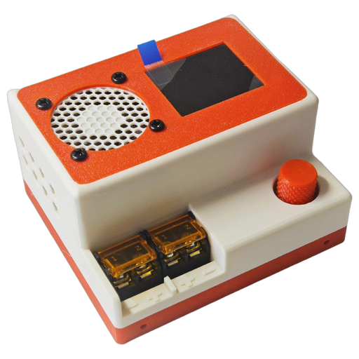

# MPPT Monitor for Home Assistant

> 太阳能充电控制器（MPPT）原生接入 Home Assistant 的自定义集成。

---

## 为什么用这个集成

**原来的版本只能通过「点灯 App」接入**，数据锁在手机 App 里，Home Assistant 拿不到，也没法做自动化、历史曲线和联动。

**这个集成直接把 MPPT 控制器接入 Home Assistant**：

- ✅ 原生 HA 实体（13 个传感器 + 1 个重启按钮），不是 App 转发
- ✅ 直接读取控制器 `http://<设备IP>:88/update`，本地局域网轮询
- ✅ 可以在 HA 里做自动化、历史曲线、Energy 能源看板、告警
- ✅ UI 添加设备，支持手动填 IP 或 **扫描网段自动发现**
- ✅ UI 里改刷新间隔，不用改代码
- ✅ 重启控制器按钮，不用再开 App

## 功能

| 功能 | 说明 |
|---|---|
| 手动添加 | 填 IP / 名称 / 账号密码 / 刷新间隔，添加前先探测设备 |
| 扫描发现 | 输入网段（默认 `10.0.30.0/24`）并发扫描 88 端口，列出发现的控制器 |
| 13 个传感器 | 当前时间、已运行时长、充电状态、风扇状态、当日电量、累计电量、散热器温度、输入功率/电压/电流、输出功率/电压/电流 |
| 重启按钮 | 对应原 rest_command 的 `/Control?Type=9&Index=0&Operation=2`，按设备自身 IP 生成 |
| 刷新间隔 | 集成「选项」里设置，1~3600 秒，改完自动生效 |
| 多设备 | 每台设备独立配置、独立实体，unique_id = `<IP>_<字段>` |

## 传感器字段映射

| 传感器 | /update 序号 | 单位 |
|---|---|---|
| 当前时间 | 0 | - |
| 已运行时长 | 1 | - |
| 充电状态 | 6 | -（未充电 / 充电中 / 充电完成）|
| 风扇状态 | 9 | -（停止 / 运行）|
| 当日电量 | 11 | Wh |
| 累计电量 | 12 | Wh |
| 散热器温度 | 13 | °C |
| 输入功率 / 电压 / 电流 | 20 / 21 / 22 | W / V / A |
| 输出功率 / 电压 / 电流 | 23 / 24 / 25 | W / V / A |

### 充电状态判定（v1.0.1 修正）

设备固件只提供两位状态（位 6：0=充电中、1=充电完成），夜间光伏电压跌到 5V 以下时仍会误报"充电中"。本集成结合光伏电压（位 21）推导出三态：

- 光伏电压 < 5V → **未充电**（夜间 / 无光照）
- 位 6 = 1 → **充电完成**
- 其余（光伏电压 ≥ 5V 且位 6 = 0）→ **充电中**

> 注：旧配置把充电状态误读为位 8（降压转换器运行状态），导致长期误显示"充电完成"，v1.0.1 已修正为位 6。

## 安装

### 方式一：HACS（推荐）

1. 点上面的 **一键添加到 HACS** 按钮，或在 HACS → 集成 → 右上角菜单 → 自定义仓库，填入：
   - 仓库：`https://github.com/qiyuetx/mppt-monitor-hacs`
   - 类别：Integration
2. 在 HACS 里搜索 **MPPT Monitor**，点击安装。
3. 重启 Home Assistant。
4. 设置 → 设备与服务 → 添加集成 → 搜索 **MPPT Monitor**。

### 方式二：手动安装

1. 下载本仓库的 `custom_components/mppt_monitor` 文件夹。
2. 放到 HA 配置目录的 `custom_components/mppt_monitor/`。
3. 重启 Home Assistant。
4. 设置 → 设备与服务 → 添加集成 → 搜索 **MPPT Monitor**。

## 使用

- **添加设备**：手动填 IP，或选扫描网段自动发现。默认账号密码 `admin / admin`（按你的控制器实际修改）。
- **改刷新间隔**：集成详情页 → 选项 → 刷新间隔（秒）。
- **重启设备**：设备页里的「重启控制器」按钮。

> 注意：如果之前用过 `rest/mppt.yaml` 这类 REST sensor 配置，建议停用/删除旧配置，避免出现重复实体。

## 兼容

- Home Assistant 2024.1.0 及以上
- 通过 HTTP 读取控制器数据，无需额外依赖

## License

MIT
